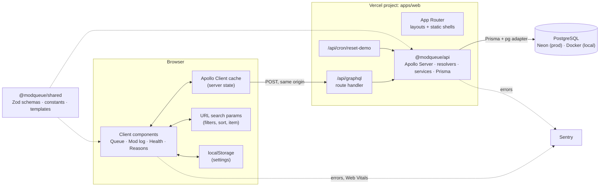
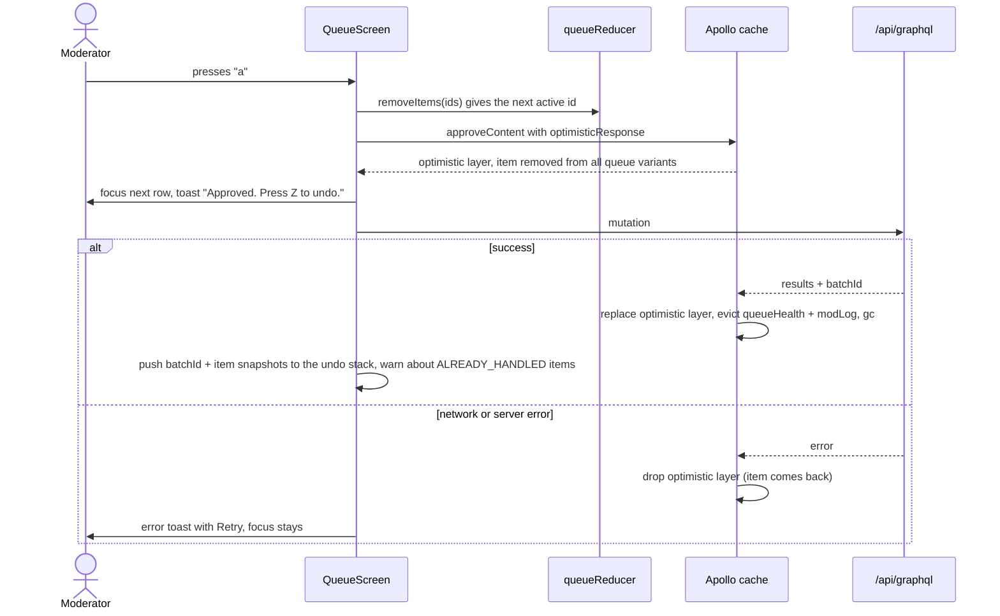

# Architecture

System overview, layers, frontend architecture and the optimistic action flow. The data model and the GraphQL API are in [api.md](api.md); the visual design is in [design.md](design.md).

## System overview

## Layers and responsibilities

| Layer | Location | Responsibility | Must not |
|---|---|---|---|
| Routes and shells | `apps/web/src/app` | Layouts, metadata, Suspense boundaries, route handlers | Contain business logic or call Prisma directly |
| Features | `apps/web/src/features/<feature>` | Screens, feature hooks, GraphQL documents, pure helpers | Import from another feature's `components/`, `hooks/` or `lib/` folders (a feature's root files and GraphQL documents are its public surface; share everything else through `lib/` or `components/`) |
| UI kit | `apps/web/src/components/ui` | Accessible, unstyled-logic primitives on Radix + tokens | Know about GraphQL or domain types |
| App-wide libs | `apps/web/src/lib` | Apollo client, URL state, media queries, formatting, monitoring | Hold feature-specific code |
| Server glue | `apps/web/src/server` | Connect `@modqueue/api` to Next.js and Sentry (`server-only`) | Be imported from client code (ESLint-enforced) |
| GraphQL API | `packages/api/src/resolvers` | Thin resolvers: parse input, call a service, map the result | Contain SQL or business rules |
| Services | `packages/api/src/services` | Business rules, transactions, Prisma queries | Know about HTTP or GraphQL |
| Shared | `packages/shared/src` | Zod schemas, constants, template rendering used by both sides | Import React, Prisma or Node-only APIs |

## Frontend architecture

**Routes**

| Route | Purpose | Rendering |
|---|---|---|
| `/` | Redirect to `/queue` | server redirect |
| `/queue` | Queue + preview + actions | static shell + client data (Suspense around `useSearchParams`) |
| `/log` | Mod log | same |
| `/health` | Queue health charts | same; charts are lazy chunks |
| `/reasons` | Removal reasons CRUD | same |
| `/api/graphql` | GraphQL endpoint (Node runtime) | route handler |
| `/api/cron/reset-demo` | Daily demo reset (Vercel Cron, `CRON_SECRET`) | route handler |
| `/api/test/reset` | E2E reset, only when `E2E_TEST_ROUTES=1`, otherwise 404 | route handler |
| `/dev/ui` | Component showcase for manual QA, 404 in production | client page |

**State ownership** (no global store, see ADR-004):

| State | Owner | Examples |
|---|---|---|
| Server data | Apollo cache | queue pages, preview, mod log, stats, reasons |
| Shareable view state | URL search params via `useUrlState` (`window.history.replaceState/pushState`, no server round trip) | filters, sort, `item`, log filters |
| Queue interaction | `queueReducer` in `useQueueState` | active item, selected ids |
| Undo history | `useUndoStack` (in memory, max 20) | last batches made in this tab, each with snapshots of its items (so undo does not depend on what is still in the Apollo cache) |
| Preferences | `SettingsProvider` + localStorage | shortcuts on/off, theme (N2) |
| Acting moderator | cookie `mq_moderator` | read by the API context |

**Data fetching:** console screens fetch in the browser with `useQuery`; server rendering outputs shells and fixed-size skeletons (ADR-005). Apollo defaults: `fetchPolicy: 'cache-and-network'`, `nextFetchPolicy: 'cache-first'`. Type policies: `Query.queue = relayStylePagination(['filter', 'sort'])`, `Query.modLog = relayStylePagination(['filter'])`.

**Keyboard model** (ADR-007):

| Key | Action | Handled by | Turned off by "single-key shortcuts: off" |
|---|---|---|---|
| `j` / `k` | Next / previous item | global `useHotkeys` | yes |
| `↓` / `↑`, `Home` / `End` | Next / previous, first / last loaded | listbox `onKeyDown` | no (standard listbox keys) |
| `x` | Select / deselect current item | global | yes |
| `Space` | Select / deselect | listbox | no |
| `a` | Approve (the selection, else the current item) | global | yes |
| `r` | Remove… (opens dialog) | global | yes |
| `b` | Ban author… (opens dialog) | global | yes |
| `z` | Undo last action | global | yes |
| `Enter` | Desktop: move focus to preview; tablet/phone: open the item sheet | listbox | no |
| `Esc` | Close sheet / clear selection / leave preview | listbox + sheet | no |
| `?` | Shortcut help | global | yes (a header button stays available) |
| `Ctrl/⌘ + Enter` | Submit the remove/ban dialog | dialog | no |

The queue list is `role="listbox"` with `aria-multiselectable="true"`. Rows are `role="option"` with `aria-selected` (= checked for bulk), `aria-posinset`, `aria-setsize={totalCount}` and a roving `tabIndex` (active row 0, others −1). Action buttons carry `aria-keyshortcuts` while shortcuts are on.

**Focus and announcement rules** (implemented in task 8.2, tested in 8.4 and in E2E; the two dialog rows are tested in 9.2):

| Event | Focus goes to | Announcement |
|---|---|---|
| Single action on the active item | Next item; if it was the last one, the previous item; if the queue is empty, the empty-state heading | Toast (polite live region): "Approved. Press Z to undo." |
| Bulk action | First remaining item after the active item | "Removed 12 items. Press Z to undo." |
| Undo | First restored item | "Undone. 1 item is back in the queue." |
| Server error (rollback) | Focus stays where it is | Error toast: "Couldn't approve 1 item. It's back in the queue." with Retry |
| Remove/ban dialog submitted | Next item (`onCloseAutoFocus` prevented, then `focusRow`) | as above |
| Dialog cancelled / `Esc` | The row that was active | none |
| Filters changed | Focus stays on the filter control; active item = first result | Announcer: "Showing 1,204 reports" |
| Item handled elsewhere (N1) | Next item, if it was the active one | Announcer: "Handled by mod_birch. Moved to the next item." |

Focus moves only when it was inside the queue region (list, preview, bulk bar, item sheet) or on `body`. It never steals focus from filters, menus or the header.

Toasts use Radix Toast, which announces its content through its own polite live region. The app-level `Announcer` is used only for messages without a toast, so nothing is announced twice.

**Responsive layout**

| Width | Layout | Opening an item |
|---|---|---|
| ≥ 1024 px (`lg`) | Grid: list `minmax(22rem, 2fr)` + preview `3fr`; preview inline | `j/k` or click → preview updates |
| 768–1023 px (`md`) | Full-width list | Click / `Enter` → `ItemSheet` slides in from the right (Radix Dialog with `data-hotkeys-scope="queue"`, so `j/k/a/r/b/z` work inside it) |
| < 768 px | Full-width list; navigation in a menu sheet | Tap → full-screen `ItemSheet` with actions in a sticky bottom bar (44 px targets). `?item=` is pushed, so Back closes it. After an action the sheet shows the next item. |

CSS decides the layout, so there is no layout shift. `useLayoutMode()` (matchMedia; server snapshot = desktop) only decides what a click does and whether the inline preview mounts.

## Optimistic action flow

