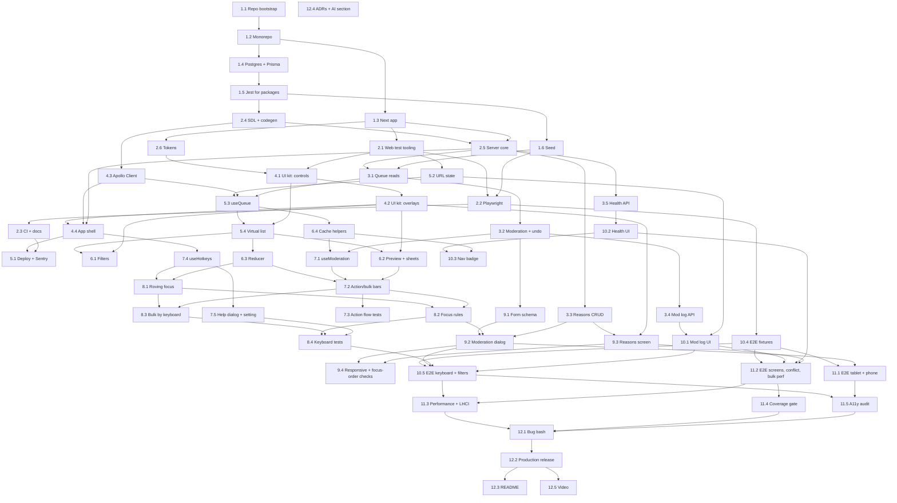

# Schedule

## Twelve days at a glance

| Day | Stage | Must (h) | Complexity | Main result |
|---|---|---|---|---|
| 1 | Foundation: repo rules, monorepo, tooling, DB, Jest for packages, seed | 6.5 | Medium | `pnpm check` green locally; 10,500 visible queue items seeded |
| 2 | Test tooling, CI, API core, design tokens | 6.5 | Medium | CI green on GitHub; `me` answers at `/api/graphql`; palette approved |
| 3 | GraphQL API: queue, moderation, undo, reasons, mod log, health | 7 | High | Complete, tested API |
| 4 | Design system, Apollo Client, app shell | 6.75 | Medium | Responsive shell built from our own UI kit |
| 5 | Deployment and monitoring; queue data and virtual list | 6.25 | High | Live URL; Sentry receives errors; scroll through 10,000+ items |
| 6 | Filters, preview, responsive sheets; queue reducer and cache helpers | 5.75 | High | Browse with filters on three layouts |
| 7 | Actions: optimistic approve, undo, rollback, conflicts; shortcut base | 6.5 | High | Approve with instant UI and undo; errors roll back |
| 8 | Keyboard model and focus management | 6 | Very high | Whole queue usable without a mouse |
| 9 | Remove/ban form, removal reasons screen | 6.5 | Medium | Remove and ban with templates and live preview |
| 10 | Mod log and queue health UI; E2E start | 7 | Medium–High | All four screens complete; keyboard triage proven in a real browser |
| 11 | E2E on tablet and phone, performance, Lighthouse CI, accessibility audit | 6.5 | High | Quality goals measured and enforced in CI |
| 12 | Bug bash, production release, README, ADRs, video | 6.75 | Low–Medium | v1.0.0 live and documented |
| | **Total** | **78 h + 18 h buffer** | | |
| 13–14 | Reserve | — | — | See below |

Each day has about 8 focused hours. The planned Must work is at most 7 h; the rest of the day is buffer for that day's tasks.

### Reserve days (13–14)

Use them in this order:

1. Must tasks that did not fit into Days 1–12.
2. Bugs from the bug bash and the manual matrix ([release.md](release.md)) that were deferred.
3. Nice-to-have items in the order of [backlog.md](backlog.md).

If the plan is more than one day late after Day 8, apply the cut line in [risks.md](risks.md) instead of counting on the reserve days.

### What changed in the 2026-11-13 revision

The first version planned 10 days. These estimates were raised: test tooling 1 h → 2.5 h (three tasks: 1.5, 2.1, 2.2); UI kit 2.75 h → 4.5 h (two tasks: 4.1, 4.2); deployment 1.75 h → 2.5 h; E2E specs 2.75 h → 4.5 h (three tasks: 10.5, 11.1, 11.2); moderation and undo 2 h → 2.5 h; roving focus and focus rules 3.25 h → 4 h; `useModeration` 2 h → 2.5 h (its tests moved into the task). The mod log and health APIs moved to Day 3, so the whole API is finished in one stage.

## Task dependencies

## Critical path and parallel work

**Critical path:** 1.1 → 1.2 → 1.4 → 1.5 → 2.4 → 2.5 → 3.1 → 5.3 → 5.4 → 6.3 → 7.2 (with 6.4 → 7.1 → 7.2 beside it) → 8.2 → 9.2 → 10.5 → 11.3 → 12.1 → 12.2 → 12.3. A delay on any of these tasks moves the release.

**Off the critical path** (good buffer fillers, or work for a second agent in a separate worktree): 9.3 Removal reasons screen (needs only 3.3, 4.2 and 4.3), 10.1–10.2 Mod log and Health UI (need only Day 3–5 work), 7.5 Shortcut help dialog, 12.4 ADRs.
